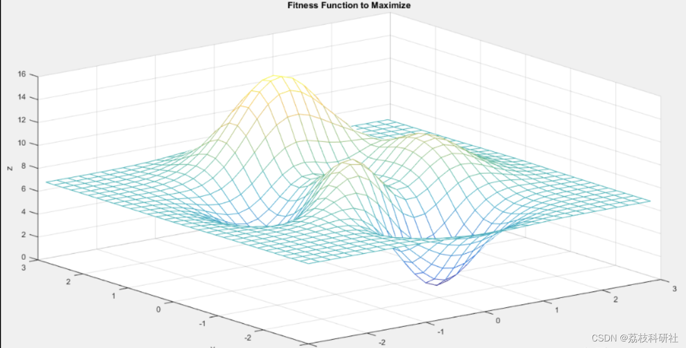
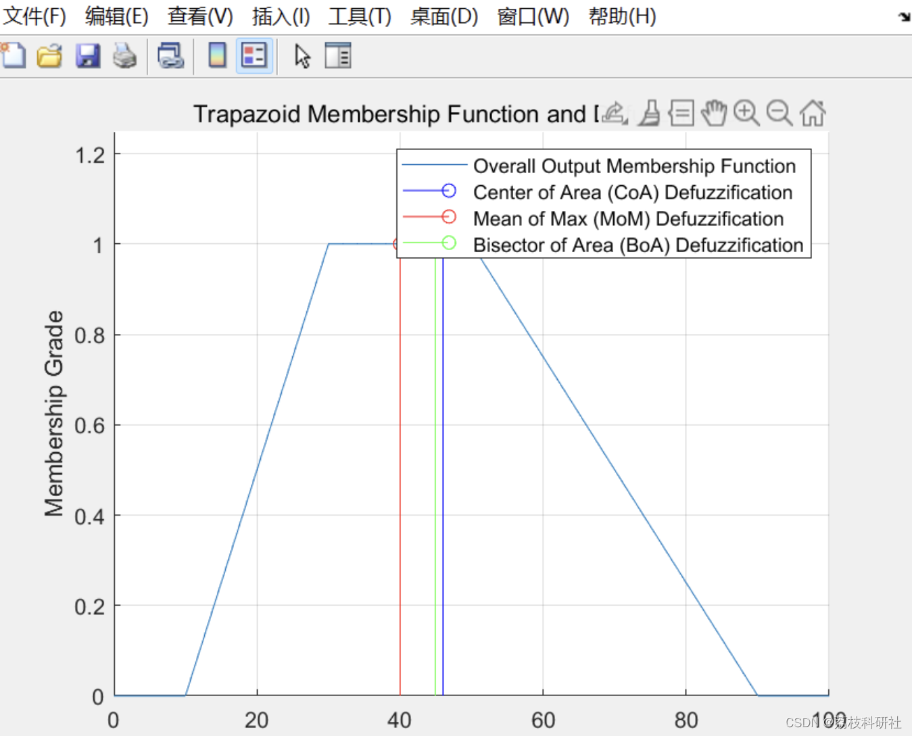
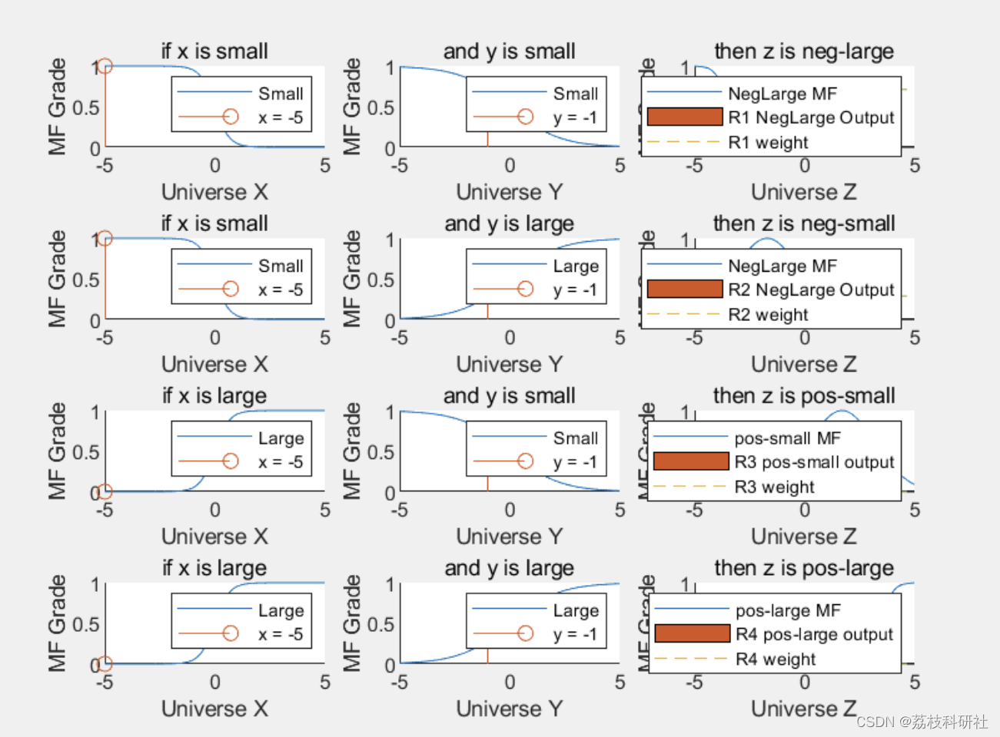
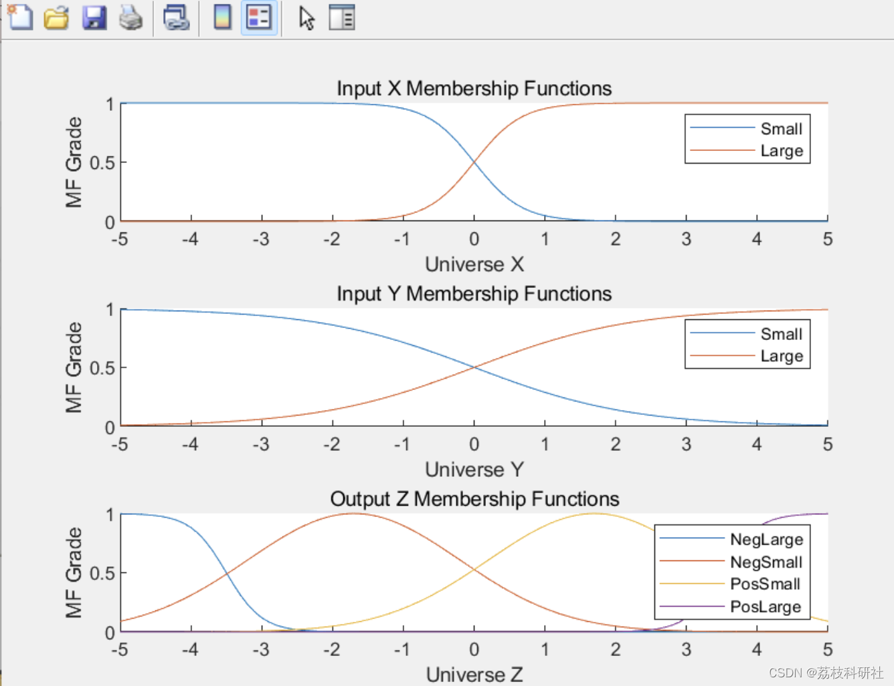
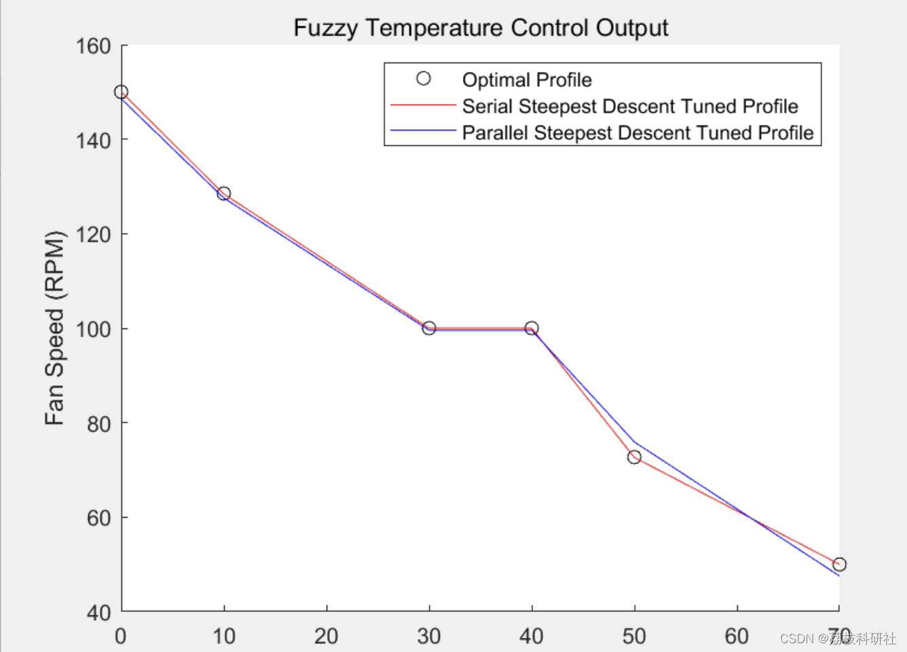
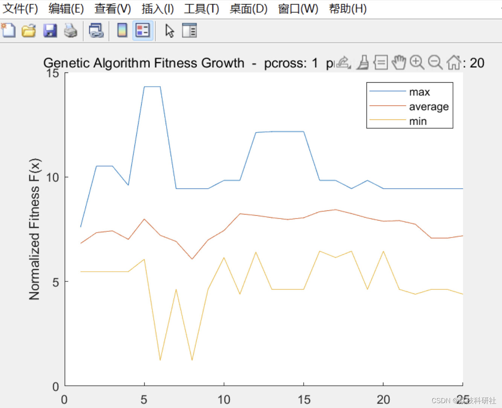
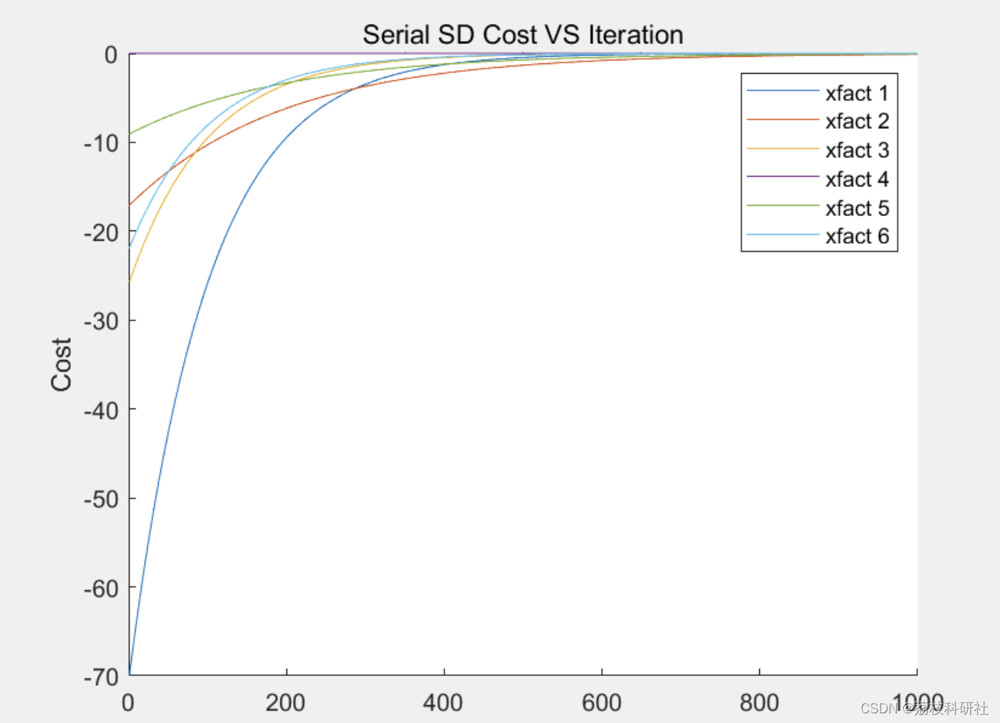

# Research on Fuzzy Neural Predictive Control Based on Compound Particle Swarm Optimization (Matlab Code Implementation)

🏆 Bloggers' Advantage: 🌞🌞🌞 The content of the blog strives for rigorous thinking and clear logic to facilitate readers.
⛳️ Mantra: Those who travel a hundred miles often finish half their journey in the last ninety minutes.
📋📋📋 The following is the outline of this article: 🎁🎁🎁 Outline💥1 Overview📚2 Running Results🎉3 References🌈4 MATLAB Code Implementation
2. Operational Results
The FLC (Fuzzy Logic Control) technology, characterized by its simplicity in controller design and strong robustness, is particularly suitable for nonlinear system control. Since the 1980s, it has been widely applied both theoretically and in engineering practice. The greatest advantage of FLC lies in its ability to describe system characteristics and control methods that are difficult to express with mathematical formulas using fuzzy set theory. This allows fuzzy control to directly apply human intelligence to the control process. However, fuzzy controllers essentially represent a type of nonlinear controller based on expert experience. There is still a lack of effective methods for accurately determining the membership functions and fuzzy control rules for each fuzzy set.
In response to the shortcomings of traditional fuzzy controllers, this paper proposes the design of FLC based on the Particle Swarm Optimization Algorithm (PSO). Firstly, to address the issue that the basic PSO algorithm easily falls into local optima, this paper analyzes the impact of the inertia weight and learning factor on the algorithm's performance and proposes an improved algorithm: the WFPSO (Weighted Inertia Weight Particle Swarm Optimization). Standard Benchmark test function experiments show that the improved PSO algorithm enhances the global search capability of particles and accelerates their convergence speed. Secondly, this improved PSO algorithm is applied to the design of fuzzy controllers, allowing for online automatic adjustment of the quantization factors ke, kec, and proportional factor ku, effectively achieving rapid dynamic performance without overshooting.
Brushless DC motors are multivariable and nonlinear control systems. Traditional controls struggle to adapt to changes in the controlled object due to parameters not being adjusted accordingly, making it difficult to achieve precise control. Therefore, applying the optimized fuzzy controller based on the improved PSO to brushless DC motor control provides a comparative study between the motor's start torque, rapidity of speed regulation, and traditional fuzzy control systems. Simulation results indicate that the optimized fuzzy controller achieves small start torque fluctuations, no overshooting or rapid rise in speed, short transition time, and strong adaptability in the system.
📚2. Operational Results
Editor
Editor
Editor
Editor
Part of the code:
hold on  
grid on  
axis([ 0 100 0 1.25])  
plot(x,mf)  
xlabel('X = Universe of Discourse');  
ylabel('Membership Grade');  
title('Trapazoid Membership Function and Defuzzification');  
% Center of Area (CoA) Defuzzification  
% z_coa = defuzz(x,mf,'centroid') % using Fuzzy Logic Toolbox  
z_coa = trapz(mf.*x)/trapz(mf); % trapz() 'estimates' integral of a trapazoid  
stem(z_coa,1,'b')  
% Mean of Max (MoM) Defuzzification  
% z_mom = defuzz(x,mf,'mom') % using Fuzzy Logic Toolbox  
index = find(mf==max(mf)); % all index(s) of mf that equal the max value  
mean_index = mean(index); % assuming the max area is contiguous...  
z_mom = x(mean_index);  % ...can use index with input vector to find z  
stem(z_mom,1,'r')  
% Bisector of Area (BoA) Defuzzification  
% z_boa = defuzz(x,mf,'bisector') % using Fuzzy Logic Toolbox  
index=1;  
while (logical(trapz(mf(1:index))~=trapz(mf(index:length(mf)))))  
index=index+1;  
end  
z_boa = x(index);  
stem(z_boa,1,'g')  
legend('Overall Output Membership Function', 'Center of Area (CoA) Defuzzification', 'Mean of Max (MoM) Defuzzification', 'Bisector of Area (BoA) Defuzzification')  
🎉3 References
🌈4 Matlab code implementation

## Images

<!-- PAYMENT_BLOCK -->

## Get this dataset

- Payment link (Stripe): [Buy now](https://buy.stripe.com/3cs8yP7sY87d0vu9AB)
- Payment QR code: 

<!-- /PAYMENT_BLOCK -->
